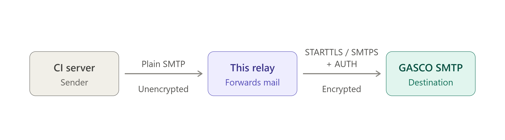

# SMTP Relay

A small SMTP relay written in Go. It accepts SMTP connections on a local
listener and forwards every message to an upstream SMTP server using
username/password (`AUTH PLAIN`) authentication.

Use case: applications that can only send unauthenticated SMTP (CI Server) on
`localhost` need to deliver mail through a provider
(GASCO SMTP Server) that requires authenticated, TLS-protected submission.

## How it works




1. The relay listens for SMTP connections (`LISTEN_ADDR`, default `:2525`).
2. On `DATA`, the full message is read and forwarded to the upstream server:
   - Port `465` uses implicit TLS (SMTPS).
   - Any other port uses plain TCP then upgrades with `STARTTLS`. If the
     upstream does not advertise `STARTTLS`, delivery is refused so
     credentials are never sent in clear text.
3. Credentials are authenticated with `AUTH PLAIN`. If `FROM_OVERRIDE` is set,
   the envelope sender is replaced (required by some providers).
4. On upstream failure the relay returns a temporary error (`451 4.4.0`) so
   the client can retry later.

## Requirements

- Go 1.21.6 or newer (to build from source)

## Configuration

Configuration is read from environment variables. Set them in the environment
or shell profile that launches the relay process;

| Variable        | Required | Default  | Description                                                                 |
|-----------------|----------|----------|-----------------------------------------------------------------------------|
| `LISTEN_ADDR`   | no       | `:2525`  | Address the relay listens on.                                               |
| `UPSTREAM_HOST` | **yes**  | —        | Upstream SMTP host, e.g. `smtp.example.com`.                                |
| `UPSTREAM_PORT` | no       | `587`    | Upstream port. Use `465` for implicit TLS (SMTPS).                          |
| `UPSTREAM_USER` | **yes**  | —        | Username for upstream authentication.                                       |
| `UPSTREAM_PASS` | **yes**  | —        | Password for upstream authentication.                                       |
| `FROM_OVERRIDE` | no       | —        | If set, replaces the envelope sender with this address.                     |

If `UPSTREAM_HOST`, `UPSTREAM_USER`, or `UPSTREAM_PASS` is missing the process
exits immediately with a fatal error.

Clients connecting to the relay are always accepted without authentication.

### Example

```sh
export LISTEN_ADDR=":2525"
export UPSTREAM_HOST="smtp.example.com"
export UPSTREAM_PORT="587"
export UPSTREAM_USER="apikey-or-username"
export UPSTREAM_PASS="secret"
```

## Build and run

Build from source:

```sh
go build -o server_relay.exe server_relay.go
```

Run (PowerShell):

```powershell
$env:UPSTREAM_HOST="smtp.example.com"
$env:UPSTREAM_USER="user"
$env:UPSTREAM_PASS="secret"
$env:LISTEN_ADDR=":2525"
.\server_relay.exe
```

A prebuilt `server_relay.exe` is included in the folder.

## Sending a test message


via Python:

```python
import smtplib
from email.message import EmailMessage

msg = EmailMessage()
msg["From"] = "sender@example.com"
msg["To"] = "recipient@example.com"
msg["Subject"] = "Test"
msg.set_content("Hello from the relay")

with smtplib.SMTP("127.0.0.1", 2525) as s:
    s.send_message(msg)
```

## Server limits

| Setting            | Value   |
|--------------------|---------|
| Read timeout       | 60 s    |
| Write timeout      | 60 s    |
| Max message size   | 25 MiB  |
| Max recipients     | 100     |

## Security notes

- The local listener is **plain text and unauthenticated**. Only bind it to
  `localhost` or a trusted, firewalled network. Do not expose it to the public
  internet.
- The relay-to-upstream hop is TLS-protected.
- Credentials are never sent upstream in clear text: implicit TLS is used on
  port `465`, and `STARTTLS` is required on all other ports.

## Project layout

```
server_relay.go   # entire relay: config, upstream forwarding, SMTP server
go.mod / go.sum   # module definition and dependency hashes
server_relay.exe  # prebuilt Windows binary
```

## Dependencies

- [`github.com/emersion/go-smtp`](https://github.com/emersion/go-smtp) — SMTP server
- [`github.com/emersion/go-sasl`](https://github.com/emersion/go-sasl) — SASL support (transitive)
